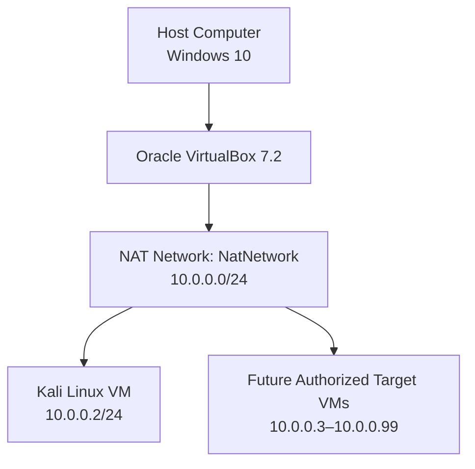

<div align="center">

<h1>🔐 Cybersecurity Lab Environment Setup</h1>

<p><strong>Building an isolated virtual lab for penetration testing and ethical hacking practice</strong></p>

<p>
  <a href="https://github.com"></a>
  
  
  
  
  
</p>

<p>
  
  <a href="https://github.com"></a>
  
  
  
  
</p>

</div>

> ⚠️ **Authorized use only:** This laboratory is intended for education and authorized security testing. Test only systems you own or have explicit permission to assess. Keep deliberately vulnerable targets isolated from production and public networks.

---

## 📌 Project Overview

This project documents the setup of a virtual cybersecurity and penetration-testing laboratory using Oracle VirtualBox and Kali Linux.

The purpose of the lab is to create a controlled environment where cybersecurity tools, network scanning, reconnaissance, vulnerability assessment, packet analysis, and other security-testing activities can be performed safely and repeatedly.

The lab uses a private VirtualBox NAT Network so additional virtual machines can be connected later and used as targets for authorized security testing.

## 🎯 Objectives

The main objectives of this project are to:

- Install and configure VirtualBox.
- Install or import Kali Linux as a virtual machine.
- Create a private NAT Network for the cybersecurity lab.
- Configure network connectivity for Kali Linux.
- Assign a consistent IP address to the Kali VM, if required.
- Verify network connectivity and DNS resolution.
- Create a clean VM snapshot for recovery.
- Document the setup process and verification results.
- Prepare the environment for future cybersecurity projects.

## 🛡️ Purpose of the Lab

The lab provides an isolated and controlled environment for cybersecurity learning and authorized security testing. It can be used for activities such as:

- Network reconnaissance
- Port scanning
- Vulnerability assessment
- Packet analysis
- Web security testing
- Exploitation practice against intentionally vulnerable lab targets
- Security-tool experimentation

**Important:** Do not use this lab or its tools to attack unauthorized systems. Keep vulnerable target machines on the dedicated lab network and do not use bridged networking for them.

## 🏗️ Lab Architecture




Additional target machines can be added to the same virtual network in future projects. Confirm your own subnet, DHCP range, gateway, and interface configuration in VirtualBox before relying on the example values in this README.

## ⚙️ Lab Configuration

The following table records the configuration described for this lab. Hardware and network values can differ on other systems.

| 🧩 Component | ⚙️ Configuration |
|---|---|
| 🖥️ Host OS | Windows 10 |
| 🧠 Host RAM | 8 GB |
| ⚡ Processor | Intel Core i7 |
| 🧰 Hypervisor | VirtualBox 7.2 |
| 🐉 Security OS | Kali Linux 2026.2 *(verify the version actually installed)* |
| 🧠 Kali RAM | 2048 MB |
| 🌐 Virtual Network | NAT Network (`NatNetwork`) |
| 📡 Network Address | `10.0.0.0/24` |
| 🐧 Kali IP Address | `10.0.0.2/24` *(example; verify locally)* |
| 🚪 Default Gateway | `10.0.0.1` *(verify in VirtualBox/network routes)* |
| 🌍 DNS Server | `8.8.8.8` *(example)* |
| 🔮 Future VM Range | `10.0.0.3–10.0.0.99` *(reserve addresses to avoid conflicts)* |

> **Networking note:** A static address should be outside the DHCP pool or reserved for the VM, otherwise an address conflict may occur. The gateway and DNS settings above are examples; verify them against your actual NAT Network configuration.

## 🪜 Lab Setup Procedure

### Step 1. Install 7-Zip

7-Zip can be used to extract a Kali Linux virtual-machine package distributed as a `.7z` archive.

- Tool: [7-Zip Downloads](https://www.7-zip.org/download.html)
- Install 7-Zip and extract the downloaded archive to a folder with sufficient disk space.

### Step 2. Install VirtualBox

Install Oracle VirtualBox on the host computer.

- Tool: [VirtualBox Downloads](https://www.virtualbox.org/wiki/Downloads)
- Follow the installer instructions and ensure hardware virtualization is enabled in BIOS/UEFI if required.

### Step 3. Create the NAT Network


In VirtualBox, open the network settings (the menu location can vary by VirtualBox version) and create a dedicated NAT Network.

| Setting | Example value |
|---|---|
| Network Name | `NatNetwork` |
| IPv4 Prefix | `10.0.0.0/24` |
| DHCP | Enabled, unless you deliberately manage addressing another way |
| IPv6 | Disabled for this example |

A NAT Network allows multiple VMs connected to that network to communicate with each other while using network address translation for outbound connectivity. Confirm the gateway and DHCP pool shown in your VirtualBox configuration.

### Step 4. Import Kali Linux

Download a VirtualBox-ready Kali image from the official Kali Linux website and import/open it in VirtualBox.

- Tool: [Kali Linux — Get Kali](https://www.kali.org/get-kali/)


Configure the VM network adapter as follows:

| Setting | Example value |
|---|---|
| Adapter | Adapter 1 |
| Attached to | NAT Network |
| Network | `NatNetwork` |
| Adapter Type | Intel PRO/1000 MT Desktop |
| Memory | `2048 MB` |

A shared folder may also be configured for transferring required files between the host operating system and Kali VM. Share only the folders needed for the lab and avoid exposing sensitive host files.

### Step 5. Configure the Kali Linux Network

Check the current interface, address, route, and NetworkManager connection before modifying network settings:


```bash
ip address
ip route
nmcli connection show
nmcli device status
```

Example intended settings for this lab:

```text
IP Address:    10.0.0.2/24
Subnet Mask:   255.255.255.0
Gateway:       10.0.0.1
DNS:           8.8.8.8
```

Use the actual connection name shown by `nmcli connection show`. You can generally keep DHCP enabled for a simple lab; for a consistent IP address, configure a DHCP reservation or a static address that does not conflict with the DHCP pool. After applying settings, reconnect and verify with `ip address` and `ip route`.

### Step 6. Create a Clean VM Snapshot

After confirming that Kali boots and network settings are correct, shut down or snapshot the VM from VirtualBox's **Snapshots** view.

Suggested snapshot name:

```text
Clean Kali - Network Setup
```

This snapshot is the clean baseline for the lab. Restore it if later experiments change or damage the VM configuration. A snapshot is not a substitute for a separate backup of important files.

## 🔎 Lab Verification

Run the following commands inside your own Kali VM. The examples assume the network values listed in the configuration table; replace them if your actual lab uses different values.

| ✅ Test | 🧾 Command | 🎯 Expected Result |
|---|---|---|
| 🌐 Check IP address | `ip a` | The intended Kali address is shown on the correct interface |
| 🧭 Check routing | `ip route` | A default route via the configured gateway is present |
| 📡 Test gateway | `ping -c 4 10.0.0.1` | Replies, if ICMP is permitted and the gateway is correct |
| 🌍 Test Internet connectivity | `ping -c 4 8.8.8.8` | Replies, if external ICMP is permitted |
| 🔎 Test DNS resolution | `nslookup networkwalks.com` | The domain resolves using the configured resolver |
| 🧰 Verify Nmap | `nmap --version` | Nmap version information is displayed |
| 🔄 Verify snapshot | Restore snapshot, then run `ip a` | The baseline VM state is restored |

### Example Results

Record your actual output here after completing the checks:

```text
Kali IP Address: 10.0.0.2/24
Default Gateway:  10.0.0.1
DNS Server:       8.8.8.8
```

These are example values, not a claim that the lab has been run on your machine. A failed ping alone does not necessarily mean the network is broken; ICMP may be blocked. Use `ip route`, DNS queries, and other relevant checks to troubleshoot.

For a separate command checklist, see [`docs/verification-commands.md`](docs/verification-commands.md).

## 🐞 Problems Encountered & Solutions

Document the symptoms, diagnosis, and verified fix for each issue you encounter. The examples below are possible troubleshooting paths, not universal fixes.

### Problem 1. Internet Connectivity After Static IP Configuration

After manually configuring IPv4, Internet connectivity can fail because of an incorrect gateway, duplicate IP, DNS configuration, or NetworkManager connection settings.

1. Identify the actual connection name:

   ```bash
   nmcli connection show
   nmcli device status
   ip route
   ```

2. Confirm that the IP address is unique, the gateway belongs to the configured subnet, and the address does not conflict with the DHCP pool.
3. Check DNS separately from IP reachability, then reconnect the relevant NetworkManager connection if needed.

A lab-specific workaround that may be encountered in notes is:

```bash
sudo nmcli connection modify "Wired connection 1" ipv4.dad-timeout 0
```

**Caution:** `Wired connection 1` is only an example connection name, and this setting is not a universal Internet-connectivity fix. Do not run it blindly. Confirm the connection name and consult `nmcli` documentation for your installed NetworkManager version before changing connection properties.

### Problem 2. VirtualBox VT-x / Virtualization Error

If the VM fails to start because hardware virtualization is disabled:

1. Restart the computer.
2. Enter the BIOS/UEFI settings.
3. Enable Intel VT-x / hardware virtualization (the option name varies by system).
4. Save the configuration and restart.
5. Start the Kali VM again.

On some systems, operating-system hypervisor settings or firmware limitations may also affect VirtualBox. Record the exact error message if enabling virtualization does not resolve the issue.

## 💡 What I Learned

Through this project, I learned how to build and document a virtual environment for cybersecurity practice.

### 1. NAT vs NAT Network

A standard VirtualBox NAT attachment and a NAT Network are different modes. A NAT Network can allow multiple VMs on the same virtual network to communicate with one another while providing outbound network address translation.

### 2. Virtual Machine Networking

VirtualBox adapters connect VMs to different network types. Adapter mode, subnet, gateway, DHCP, and firewall settings all affect connectivity.

### 3. Static IP Configuration

I learned how to inspect and configure IPv4 addresses, subnet masks, default gateways, and DNS settings in Kali Linux, and why address conflicts should be avoided.

### 4. VM Snapshots

A clean snapshot provides a known-good recovery point before experiments. Important files should still be backed up separately.

### 5. Documentation

Documenting commands, configuration, screenshots, problems, and verified solutions makes a lab repeatable and easier to troubleshoot.

## 🔐 Security & Ethical Use

This environment is for educational use and authorized testing only.

- Scan only your own lab machines or systems for which you have explicit authorization.
- Keep intentionally vulnerable targets on the dedicated private lab network.
- Do not expose vulnerable services to the public Internet or bridge vulnerable VMs onto a trusted LAN.
- Avoid committing passwords, tokens, private keys, VM disk images, or personal information to GitHub.
- Take a snapshot before significant configuration changes or risky experiments.

## 🔗 Tools & Resources

- [7-Zip Downloads](https://www.7-zip.org/download.html)
- [VirtualBox Downloads](https://www.virtualbox.org/wiki/Downloads)
- [Kali Linux Downloads](https://www.kali.org/get-kali/)
- [Kali Linux Documentation](https://www.kali.org/docs/)

## 👤 Author

Replace the example fields below with your own details before publishing:

- **Name:** Ayush Shukla
- **Course / Cohort:** Cybersecurity Professional B084 *(edit as applicable)*
- **LinkedIn:** https://lnkd.in/p/gUu3aJAS
- **GitHub:** https://github.com/Hacker-Ayush-py03/Network_Walks

## 📌 Project Information

- **Program Name:** Cybersecurity at Networkwalks *(edit as applicable)*
- **Week:** 01
- **Project:** Cybersecurity & Pentesting Lab Setup
- **Repository:** https://github.com/Hacker-Ayush-py03/Network_Walks/blob/main/README.md

---

*This README is a project template. Update the configuration, screenshots, author information, and verification results to reflect your own lab before presenting it as completed work.*
