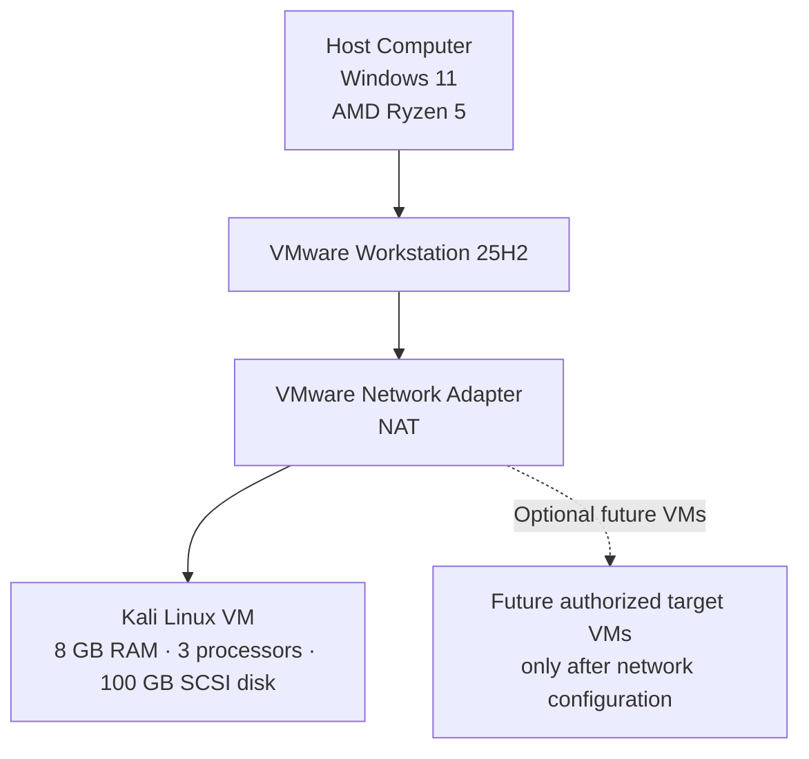

<div align="center">

<h1>🔐 Cybersecurity Lab Environment Setup</h1>

<p><strong>Building an isolated virtual lab for penetration testing and ethical hacking practice</strong></p>

<p>
  
  
  
  
  
</p>

<p>
  
  
  
  
</p>

<p>
  
  
  
  
</p>

</div>

---

## 📌 Project Overview

This project documents the setup of a **Kali Linux cybersecurity and penetration-testing laboratory** running on **Windows 11** using **VMware Workstation 25H2**. The VMware hardware values in this README are based on the VM Settings screenshot included in this repository.

The lab is intended for practicing Linux administration, networking, reconnaissance, packet analysis, vulnerability assessment, and security tools in a controlled environment. The current virtual network adapter is configured as **NAT**. The Kali guest's actual IP address, subnet, gateway, and DNS must be recorded from the running VM; these values are not visible in the supplied settings screenshot.

> ⚠️ **Authorized use only:** Use this lab only for systems you own or have explicit permission to test. VMware NAT provides network address translation, but it should not be treated as a guarantee of complete isolation.

---

## 🎯 Objectives

The main objectives of this project are to:

- Document the Windows 11 host and VMware Workstation 25H2 environment.
- Configure and review a Kali Linux virtual machine.
- Record the VM's assigned memory, processor setting, virtual disk, CD/DVD device, and network adapter.
- Connect the Kali VM through VMware's NAT networking.
- Check the guest's IPv4 address, subnet, default route, and DNS configuration.
- Verify basic connectivity and DNS resolution.
- Create a clean VM snapshot as a recovery point.
- Record screenshots, commands, problems, and solutions.
- Prepare the environment for future authorized cybersecurity exercises.

---

## 🛡️ Purpose of the Lab

This lab provides an environment for cybersecurity learning and authorized security testing, including:

- Network reconnaissance on authorized lab systems
- Port scanning of owned or intentionally vulnerable virtual machines
- Vulnerability assessment
- Packet analysis
- Web security testing against local test applications
- Exploitation practice in a deliberately vulnerable lab
- Linux administration and security-tool experimentation

**Important:** Do not scan or attack public systems or other networks without explicit authorization. Use a host-only or appropriately configured custom network when a lab requires stronger separation from the host's normal network.

---

## 🏗️ Lab Architecture



The diagram represents the intended lab structure. The exact guest IP range and gateway have not been inferred from the screenshot; verify them in Kali and VMware before documenting them.

---

## ⚙️ Lab Configuration

The following details are from the user's provided host information and VMware Workstation VM Settings screenshot.

| 🧩 Component | ⚙️ Configuration |
|---|---|
| 🖥️ Host OS | **Windows 11** |
| ⚙️ Host Processor | **AMD Ryzen 5** *(exact Ryzen 5 model not provided)* |
| 🧰 Hypervisor | **VMware Workstation 25H2** |
| 🐉 Guest OS | Kali Linux *(exact installed release should be confirmed inside the VM)* |
| 🧠 VM Memory | **8 GB (8192 MB)** |
| ⚡ VM Processors | **3** *(as shown in VMware settings)* |
| 💾 Virtual Hard Disk | **100 GB, SCSI** |
| 💿 CD/DVD Device | **SATA**, attached to a Kali Linux ISO file |
| 📂 ISO File Path | Visible beginning: `D:\kali-linux-2025...` *(truncated in screenshot; confirm the full name in VMware settings)* |
| 🌐 Network Adapter | **NAT** |
| 🔌 USB Controller | Present |
| 🔊 Sound Card | Auto detect |
| 🖥️ Display | Auto detect |
| 🧠 Physical Host RAM | do not confuse this with the VM's allocated 8 GB |
| 📡 Kali IP Address |  obtain from `ip -br address` |
| 🚪 Default Gateway |  obtain from `ip route` |
| 🌍 DNS Server | check NetworkManager/resolver settings |
| 🔮 Future Target VMs | Add only after confirming the intended virtual network and isolation requirements |

### 📸 VMware Workstation VM Settings

The screenshot below records the VM settings used for the configuration table.


---

## 🪜 Lab Setup Procedure

### Step 1. Confirm the Host Environment

The host details for this lab are:

- Operating system: Windows 11
- Processor: AMD Ryzen 5
- Hypervisor: VMware Workstation 25H2

The exact Ryzen 5 model and total physical host RAM were not supplied, so they are not listed as specific model/capacity values here.

### Step 2. Download Kali Linux

Download Kali Linux installation media or a VMware-ready virtual machine from the official Kali Linux website:

**Official resource:** [Kali Linux — Get Kali](https://www.kali.org/get-kali/)


Once Kali boots, check the actual installed release with:

```bash
cat /etc/os-release
```

### Step 3. Review the VMware Virtual Hardware

Open VMware Workstation, select the Kali VM, and choose **Edit virtual machine settings**. Confirm the values shown in the following table.

| VMware Device | Setting to Confirm |
|---|---|
| Memory | `8192 MB` |
| Processors | `3` |
| Hard Disk (SCSI) | `100 GB` |
| CD/DVD (SATA) | Using the intended Kali Linux ISO file |
| Network Adapter | `NAT` |
| USB Controller | Present |
| Sound Card | Auto detect |
| Display | Auto detect |

Shut down the guest before changing hardware settings unless VMware explicitly supports changing that setting while the VM is running. The 8 GB figure is the memory allocated to the **virtual machine**, not the total RAM installed in the Windows host.

### Step 4. Configure the VMware Network Adapter

1. Open **VM Settings → Network Adapter**.
2. Confirm that **NAT** is selected.
3. Enable **Connected** and **Connect at power on** if those options are available.
4. Start Kali Linux and log in.
5. Check the guest's actual network configuration before making any static-IP changes.


Run these commands inside Kali:

```bash
ip -br address
ip route
nmcli device status
nmcli device show
```


Do not assume that the guest uses `10.0.0.2`, the gateway is `10.0.0.1`, or DNS is `8.8.8.8`. Those were values from a different example and are **not confirmed** by the VMware screenshot. Start with DHCP unless your lab requires a fixed address and you have confirmed the VMware NAT subnet, gateway, DNS, and DHCP address pool.


### Step 5. Verify Connectivity and DNS

Use the commands in the **Lab Verification** table below. If an IP test works but a hostname does not resolve, investigate DNS separately. A failed ping by itself does not prove that networking is broken because ICMP may be filtered.


### Step 6. Create a Clean VM Snapshot

After Kali boots reliably and the initial network configuration is documented, create a baseline snapshot in VMware Workstation using the Snapshot menu or Snapshot Manager.

Suggested snapshot name:

```text
Clean Kali - Initial Setup
```

A snapshot is a convenient recovery point for VM state, but it is not a substitute for a separate backup of important files.

---


## 🔎 Lab Verification

Run these commands inside your own Kali VM. Record the actual output in your lab notes rather than copying assumed IP, gateway, or DNS values.

| ✅ Test | 🧾 Command | 🎯 Expected Result |
|---|---|---|
| 🐉 Check Kali release | `cat /etc/os-release` | Installed OS/release information is displayed |
| 🌐 Check IP address | `ip -br address` | An address is shown on the connected network interface |
| 🚪 Check gateway/default route | `ip route` | Default route is displayed when provided by the network |
| 🧰 Check network state | `nmcli device status` | Network interface state is shown |
| 🌍 Check DNS configuration | `nmcli device show` | DNS and interface information is displayed where available |
| 📡 Test outbound IP connectivity | `ping -c 4 1.1.1.1` | Replies if outbound access and ICMP are permitted |
| 🔎 Test DNS resolution | `getent hosts kali.org` | Hostname resolves when DNS is working |
| 🧪 Verify Nmap | `nmap --version` | Installed Nmap version is displayed |
| 🔄 Verify snapshot | Restore baseline snapshot and rerun `ip -br address` | Saved VM state is restored |

To test the gateway, first read its address from `ip route` and then run `ping -c 4 <gateway-address>` using the actual gateway value. Only perform host discovery against a subnet that you own or have explicit permission to test.


For a compact checklist, see [`docs/verification-commands.md`](docs/verification-commands.md).

---

## 🐞 Problems Encountered & Solutions

Document the exact error message and solution that you personally verified. The following are troubleshooting steps to use if the corresponding problem occurs; they are not claims that every issue happened on this machine.

### Problem 1. Kali Has No Network Connectivity

1. Confirm the VMware Network Adapter is set to **NAT** and is connected.
2. In Kali, run `ip -br address` and `ip route` to inspect the interface and route.
3. Run `nmcli device status` to confirm whether NetworkManager sees the interface as connected.
4. If the guest has no IPv4 address, inspect the active NetworkManager connection and DHCP status before setting an address manually.
5. If IP connectivity works but hostnames fail, inspect DNS using `nmcli device show` and `cat /etc/resolv.conf`.
6. Check VMware's NAT/network service configuration if the guest is not receiving an address or route.

Do not paste a guessed gateway or DNS server into the configuration. First confirm the values for this VM's actual NAT network.

### Problem 2. Hardware Virtualization Error

If VMware reports that hardware virtualization is unavailable on this AMD Ryzen host:

1. Restart Windows and open the system BIOS/UEFI settings.
2. Locate the AMD virtualization setting, commonly labelled **SVM Mode** or **AMD-V**, if available.
3. Enable it, save the firmware changes, and restart the computer.
4. Retry the VM and follow the exact guidance in the displayed VMware error if it still fails.

Firmware menu names vary by motherboard manufacturer. Do not change unrelated security or virtualization settings without understanding the impact.

### Problem 3. Kali VM Runs Slowly

The screenshot shows **8 GB of RAM** and **3 processors** assigned to Kali. VM performance also depends on the host's physical RAM, exact Ryzen 5 model, and other running applications. If Windows becomes unresponsive, shut down the VM and reduce the assigned resources to a level the host can comfortably support.

---

## 💡 What I Learned

Through this project, I practiced or documented the following concepts:

1. **Virtualization:** VMware Workstation runs a guest operating system using virtual hardware.
2. **VM resource allocation:** Memory, processor settings, virtual disks, removable media, and devices can be configured for the guest separately from the host.
3. **NAT networking:** A NAT-connected VM can usually initiate outbound connections through the host, but NAT should not be described as complete isolation.
4. **Network troubleshooting:** `ip`, `nmcli`, and DNS lookup commands help identify address, route, interface, and name-resolution problems.
5. **Snapshots:** A clean snapshot provides a convenient rollback point before experiments.
6. **Documentation:** Tables, screenshots, command output, and verified troubleshooting notes make a technical lab easier to reproduce.

---

## 🔐 Security & Ethical Use

This lab is for education and authorized testing only. Test systems you own or have explicit permission to assess. Keep deliberately vulnerable targets off production and public networks. For stronger separation, evaluate a host-only or carefully configured custom virtual network instead of relying on NAT alone.

---

## 🔗 Tools & Resources

- **Kali Linux downloads:** [https://www.kali.org/get-kali/](https://www.kali.org/get-kali/)
- **Kali Linux documentation:** [https://www.kali.org/docs/](https://www.kali.org/docs/)
- **VMware Workstation / Fusion:** [https://www.vmware.com/products/desktop-hypervisor/workstation-and-fusion](https://www.vmware.com/products/desktop-hypervisor/workstation-and-fusion)
- **Broadcom Support Portal:** [https://support.broadcom.com/](https://support.broadcom.com/)
- **Nmap Reference Guide:** [https://nmap.org/book/man.html](https://nmap.org/book/man.html)
- **Report Drive Link:** [https://nmap.org/book/man.html]()
---

## 👤 Author

**Name:** Ayush Shukla  
**Course / Cohort:** Cybersecurity Professional B084
**GitHub:**  https://github.com/Hacker-Ayush-py03/Network_Walks 
**LinkedIn:** https://lnkd.in/p/gUu3aJAS


---

## 📌 Project Information

| Field | Details |
|---|---|
| Program Name | Cybersecurity Lab Setup |
| Compnay Name | Network Walks|
| Week | 01  |
| Project | Cybersecurity & Penetration Testing Lab Setup |
| Host OS | Windows 11 |
| Host Processor | AMD Ryzen 5 |
| Hypervisor | VMware Workstation 25H2 |
| Guest OS | Kali Linux |
| Virtual Network | NAT |
| Repository | GitHub |

---

<div align="center">
  <sub>Created for cybersecurity learning and authorized lab practice.</sub>
</div>
