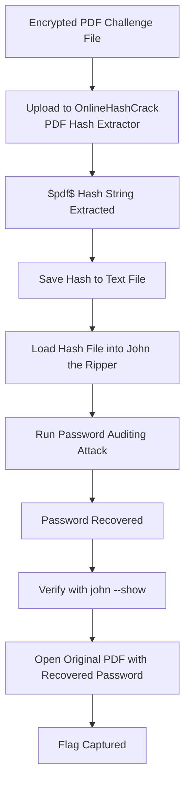

<div align="center">

# 🔐 Password Cracking with John the Ripper (JTR)
### NetworkWalks Cybersecurity & Ethical Hacking Internship — Week 3 · Project Module 1


**Author:** Ayush Shukla &nbsp;|&nbsp; **GitHub:** [@Hacker-Ayush-py03](https://github.com/Hacker-Ayush-py03)
**Parent Repository:** [NETWORK_WALKS](https://github.com/Hacker-Ayush-py03/NETWORK_WALKS)

</div>

---

## 📑 Table of Contents

1. [Internship Information](#-internship-information)
2. [Project Introduction](#-project-introduction)
3. [Project Objectives](#-project-objectives)
4. [Background — What Is John the Ripper?](#-background--what-is-john-the-ripper)
5. [Tools & Technologies Used](#-tools--technologies-used)
6. [PDF Hash Extraction Methodology](#-pdf-hash-extraction-methodology)
7. [Password Auditing Methodology](#-password-auditing-methodology)
8. [Step-by-Step Workflow](#-step-by-step-workflow)
9. [Hash Analysis](#-hash-analysis)
10. [Recovered Passwords & Captured Flags](#-recovered-passwords--captured-flags)
11. [Results Summary](#-results-summary)
12. [Recovered Passwords & Flags](#-recovered-passwords--flags)
13. [Key Technical Learnings](#-key-technical-learnings)
14. [Security Recommendations](#-security-recommendations)
15. [Conclusion](#-conclusion)
17. [Author Information](#-author-information)
18. [References](#-references)

---

## 🏢 Internship Information

| Field | Detail |
|---|---|
| Program | NetworkWalks — Cybersecurity & Ethical Hacking Internship |
| Batch | B084 |
| Week | Week 3 |
| Project Module | PM1 — Password Cracking with John the Ripper |
| Student | Ayush Shukla |
| Repository | `NETWORKWALKS-B084-WK3-PM1-PASSWORD-CRACKING-JTR` |
| Parent Repo | [NETWORK_WALKS](https://github.com/Hacker-Ayush-py03/NETWORK_WALKS) |
| Related Work | [Week 2 — PM1/PM4/PM5 Penetration Testing](https://github.com/Hacker-Ayush-py03/NETWORK_WALKS/tree/main/NETWORKWALKS-B084-WK2-PM1-PM4-PM5-PENETRATION-TESTING) |

> **Scope note:** This repository documents **Week 3, Project Module 1** only. It is an independent directory inside the parent `NETWORK_WALKS` repository and does not duplicate or modify Week 1 / Week 2 content.

---

## 📘 Project Introduction

This project is a practical password-auditing exercise completed as part of the NetworkWalks Cybersecurity & Ethical Hacking Internship (Batch B084). The assignment, **"Password Cracking with JTR,"** required recovering the passwords of **three password-protected PDF challenge files** using **John the Ripper (JTR)**, a widely used open-source password-auditing tool.

The exercise simulates a real-world offensive security / password-audit scenario: a security analyst is given encrypted documents and must determine whether the passwords protecting them are weak enough to be recovered through offline guessing — a task directly relevant to password-policy auditing, digital forensics, and penetration testing engagements.

All PDF files used in this exercise were **authorized training challenge files** supplied as part of the internship curriculum, and the exercise was carried out strictly for educational password-security auditing purposes.

---

## 🎯 Project Objectives

- Understand how PDF password protection and encryption work at a conceptual level.
- Extract the password hash embedded in an encrypted PDF file.
- Load the extracted hash into John the Ripper for offline password auditing.
- Recover the original password protecting each of the three challenge PDFs.
- Validate each recovered password by successfully opening the corresponding PDF.
- Retrieve and document the challenge flag contained in each unlocked PDF.
- Document the complete methodology, commands, and results in a professional, reproducible format.

---

## 🧠 Background — What Is John the Ripper?

**John the Ripper (JTR)** is a free, open-source password-auditing and recovery tool originally created by Openwall. It is one of the most widely used tools in offensive security and digital forensics for testing the strength of passwords protecting files, operating system accounts, and various application-specific hash formats.

JTR works by taking a hash (a one-way mathematical representation of a password, extracted from a protected file or account database) and testing candidate passwords against it — using wordlists, rule-based mutations, or brute-force generation — until a match is found. It does **not** "decrypt" the password; rather, it recreates the hashing/key-derivation process for each guess and compares the result to the stored hash.

The **Jumbo** community-maintained build of John the Ripper extends the original tool with support for a very large number of additional hash and file formats, including the PDF format used in this project.

**Johnny** is the official graphical front-end for John the Ripper, allowing hash files to be loaded and attacks configured through a GUI instead of the command line. The assignment brief references Johnny as an optional interface; this project's recovery work was carried out using **John the Ripper directly via the command line**.

---

## 🛠 Tools & Technologies Used

| Tool | Purpose |
|---|---|
| **John the Ripper (JTR)** | Primary password-auditing / hash-cracking engine used to recover the PDF passwords. |
| **OnlineHashCrack — PDF Hash Extractor** | Web-based utility used to extract the `$pdf$` hash string from each encrypted PDF challenge file. |
| **Text editor** | Used to store each extracted hash in a plain-text hash file for use with John the Ripper. |
| **PDF reader** | Used to validate each recovered password by opening the original encrypted PDF. |
| Linux / Windows lab environment | General-purpose OS environment in which the auditing was carried out. |

---

## 🔍 PDF Hash Extraction Methodology

Before John the Ripper can attempt to recover a password, the relevant password-verification data inside the PDF must be converted into a crackable hash string. This project used the **OnlineHashCrack PDF Hash Extractor** ([onlinehashcrack.com](https://www.onlinehashcrack.com/tools-pdf-hash-extractor.php)) for this step:

1. Each of the three encrypted PDF challenge files was uploaded to the extractor tool.
2. The tool parsed the PDF's encryption dictionary (owner/user password hash material, revision number, key length, and permissions flags) and produced a `$pdf$`-prefixed hash string for each file.
3. Each hash string was copied and saved into its own plain-text hash file for use with John the Ripper.

> ⚠️ **Note on third-party hash extraction:** PDF files should only be uploaded to a third-party extraction service when you are authorized to do so and the files do not contain sensitive or confidential content. In this project, only authorized training challenge files supplied by the internship program were uploaded.

---

---

## 📝 Saving Extracted Hashes Using Nano Text Editor

After extracting the PDF-compatible password hashes from the three challenge files using the **OnlineHashCrack PDF Hash Extractor**, I saved each extracted hash separately using the Nano text editor in Kali Linux.

Instead of storing all three hashes in a single file, I created three individual hash files to keep the assessment organized and allow John the Ripper to process each PDF independently.

### Hash File Creation

**PDF 1 — First Hash File**

```bash
nano pdf.hash
```

The extracted hash of PDF File 1 was pasted into the Nano editor and saved as `pdf.hash`.

**PDF 2 — Second Hash File**

```bash
nano pdf.hash2
```

The extracted hash of PDF File 2 was pasted into the Nano editor and saved as `pdf.hash2`.

**PDF 3 — Third Hash File**

```bash
nano pdf.hash3
```

The extracted hash of PDF File 3 was pasted into the Nano editor and saved as `pdf.hash3`.

### Saving the Files in Nano

For each hash file, I followed these steps:

1. Opened the file using the `nano` command.
2. Pasted the corresponding extracted `$pdf$` hash.
3. Pressed `CTRL + O` to write and save the file.
4. Pressed `ENTER` to confirm the filename.
5. Pressed `CTRL + X` to exit the Nano editor.

### Final Hash File Structure

After saving all three hashes, the following files were available in the Kali Linux working directory:

```text
pdf.hash
pdf.hash2
pdf.hash3
```

Each file contained the extracted PDF hash corresponding to its respective challenge document.

---

## ⚡ Using John the Ripper on the Saved Hash Files

Once all three hash files were prepared, I used **John the Ripper (Jumbo)** with the RockYou wordlist to perform dictionary-based password auditing.

Each hash file was processed separately using the following commands.

### PDF File 1

```bash
john --format=pdf --wordlist=/usr/share/wordlists/rockyou.txt pdf.hash
```


### PDF File 2

```bash
john --format=pdf --wordlist=/usr/share/wordlists/rockyou.txt pdf.hash2
```


### PDF File 3

```bash
john --format=pdf --wordlist=/usr/share/wordlists/rockyou.txt pdf.hash3
```


### Verifying the Recovered Passwords

After running the dictionary attacks, I used John's `--show` option to display the recovered passwords.

```bash
john --show --format=pdf pdf.hash
```


```
john --show --format=pdf pdf.hash2
```


```
john --show --format=pdf pdf.hash3
```


John the Ripper confirmed successful password recovery for all three PDF hash files.

**Result:** All three supplied PDF password hashes were successfully recovered.

---
## 🔐 Password Auditing Methodology

Once the hashes were extracted, offline password auditing was performed:

1. Each `$pdf$` hash was loaded into John the Ripper.
2. John the Ripper identified the hash as a PDF-format hash (via its `$pdf$` signature) and prepared the appropriate cracking routine for the PDF encryption revision described in the hash.
3. Candidate passwords were tested against the hash using John the Ripper's cracking modes until a match was found for each of the three files.
4. Each recovered password was confirmed using `john --show` against its hash file.
5. Each recovered password was then used to manually open the corresponding original PDF, confirming the password was correct and revealing the embedded challenge flag.

This is referred to as **offline password auditing** because the guessing process happens entirely on the auditor's own machine against the extracted hash — no further interaction with the original protected file (beyond the final manual validation step) is required to test candidate passwords.

---

## 🧭 Step-by-Step Workflow



| Step | Action |
|---|---|
| 1 | Obtain the three password-protected PDF challenge files. |
| 2 | Extract the `$pdf$` hash of each file using the OnlineHashCrack PDF Hash Extractor. |
| 3 | Save each hash into its own hash text file.|
| 4 | Load each hash file into John the Ripper. |
| 5 | Run a password-recovery attack against each hash. |
| 6 | Confirm the recovered password with `john --show`. |
| 7 | Open the original PDF using the recovered password. |
| 8 | Record the challenge flag revealed inside the unlocked PDF. |

*(The assignment brief also describes an optional path using **Johnny**, the GUI front-end for John the Ripper, for steps 4–6. This project's recovery work was performed via the John the Ripper command line; Johnny was not used for the documented results.)*

---

## 🧬 Hash Analysis

All three extracted hashes follow John the Ripper's `$pdf$` hash format, which encodes the PDF's encryption parameters alongside the actual key-derivation material. In general terms, the structure is:

```
$pdf$<version>*<revision>*<key length>*<permissions>*<encrypt-metadata flag>*<ID length>*<ID>*<U-length>*<U-string>*<O-length>*<O-string>
```

| Component | Meaning |
|---|---|
| `$pdf$` | Format signature identifying this as a John the Ripper PDF hash. |
| Version / Revision | The PDF standard security handler version and revision used for encryption. |
| Key length | Length (in bits) of the encryption key, e.g. 128-bit RC4/AES. |
| Permissions value | The signed integer encoding the document's permission flags. |
| ID / U / O fields | Hexadecimal material derived from the document ID and the owner/user password verification strings, used by John the Ripper to test each candidate password without needing the original file. |

This structure is why a `$pdf$` hash is sufficient on its own for offline auditing — it contains everything John the Ripper needs to simulate the PDF's password-check routine for each guess.

<details>
<summary><b>See <code>results/RECOVERED_RESULTS.md</code> for all three full hash strings, exactly as extracted.</b></summary>

The complete, unmodified hash for each of the three challenge files is documented in [`results/RECOVERED_RESULTS.md`](results/RECOVERED_RESULTS.md).

</details>

---

## 🏁 Recovered Passwords & Captured Flags

> Full, unmodified results — passwords, flags, and extracted hash strings — are documented in [`results/RECOVERED_RESULTS.md`](results/RECOVERED_RESULTS.md). The table below summarizes the mapping between each challenge file, its recovered password, and its captured flag.

## 📊 Results Summary

| Challenge | Recovered Password | Captured Flag | Status |
|---|---|---|---|
| Challenge 1 — File 1 | `good-luck` | `nw{cybersecurity_flag_captured_2608}` | ✅ Recovered & Verified |
| Challenge 2 — File 2 | `password1` | `nw{networkwalks_persistence_jtr_270521}` | ✅ Recovered & Verified |
| Challenge 3 — File 3 | `1qaz2wsx` | `nw{networkwalks_flag_260821_1}` | ✅ Recovered & Verified |

All three passwords were recovered using John the Ripper, and all three PDFs were successfully opened with their recovered password to confirm correctness and retrieve the flag.

---

## 🖼 Screenshot Evidence

| # | Evidence | Placeholder |
|---|---|---|
| 1 | Original PDF challenge files | `
` |
| 2 | Hash Calculator homepage | `
` |
| 4 | File 1 – extracted PDF hash | `
` |
| 5 | File 2 – extracted PDF hash | `
` |
| 6 | File 3 – extracted PDF hash | `
` |
| 7 | JOHN THE RIPPER | `
` |
| 9 | Dictionary / wordlist selection | `
` |
| 11 | File 1 – recovered password | `
` |
| 12 | File 2 – recovered password | `
` |
| 13 | File 3 – recovered password | `
` |
| 15 | Final flag verification | `


` |

## 🎓 Key Technical Learnings

- How PDF password protection relies on a key-derivation process that can be represented as an offline-crackable hash.
- Why extracting a hash from a protected file enables **offline** auditing, without repeatedly opening the original file for every guess.
- The practical role of wordlists and rule-based mutation in recovering real-world, human-chosen passwords.
- How to read and interpret the structure of a `$pdf$` format hash.
- The importance of verifying a tool's supported format names/labels against the specific build installed, rather than assuming they match documentation or other versions.
- How to validate a recovered password independently (by actually opening the file) rather than trusting the cracking tool's output alone.
- The difference between **encryption** (reversible, key-based) and **hashing** (one-way, verification-based) and why PDF password audits work with the latter concept even though PDF protection itself is implemented via encryption.

---

## 🛡 Security Recommendations

Based on this exercise, the following recommendations apply to real-world PDF and document password protection:

- **Avoid short, common, or pattern-based passwords** (e.g. keyboard-walk patterns, single dictionary words with minor substitutions, or a dictionary word plus a short number sequence) — all of which are quickly recoverable with wordlist and rule-based attacks.
- **Use long, high-entropy passphrases** rather than short complex-looking passwords; length contributes more resistance against offline guessing than symbol substitution alone.
- **Prefer modern encryption revisions** (PDF 2.0 / AES-256) over legacy RC4-based protection where document software supports it.
- **Treat PDF password protection as a access-control measure, not a cryptographic guarantee of confidentiality** for highly sensitive material — combine it with proper access control and secure storage.
- **Be cautious with third-party hash-extraction or cracking services** — never upload files containing real sensitive or confidential data to a public online tool.

---

## ✅ Conclusion

This project demonstrated a complete, end-to-end password-auditing workflow against three encrypted PDF challenge files: extracting each file's password hash, loading it into John the Ripper, recovering the password through offline auditing, and independently validating each result by opening the original file and capturing its flag. All three challenges were completed successfully, reinforcing practical skills in password-hash analysis, offline password recovery, and secure, authorized use of third-party security tooling — directly applicable to penetration testing and password-policy auditing work.

---

## 👤 Author Information

**Ayush Shukla**
B.Tech Cybersecurity Student — Bikaner Technical University (BTU)
Aspiring Penetration Tester / VAPT Analyst

[](https://github.com/Hacker-Ayush-py03)

---

## 📚 References

- John the Ripper (Openwall) — [https://www.openwall.com/john/](https://www.openwall.com/john/)
- Johnny (JTR GUI) — [https://openwall.info/wiki/john/johnny](https://openwall.info/wiki/john/johnny)
- OnlineHashCrack PDF Hash Extractor — [https://www.onlinehashcrack.com/tools-pdf-hash-extractor.php](https://www.onlinehashcrack.com/tools-pdf-hash-extractor.php)

---

<div align="center">

*This project was completed as authorized coursework for the NetworkWalks Cybersecurity & Ethical Hacking Internship, using training challenge files supplied for educational password-security auditing purposes.*

</div>
